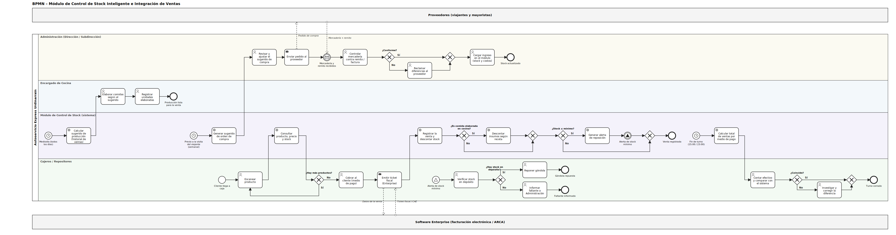

# 🛒 Módulo de Control de Stock e Integración de Ventas

> **Trabajo Práctico Integrador – Consolidado (Entregas 1 a 4)**
> **Asignatura:** Organización Empresarial | **Institución:** Universidad Tecnológica Nacional (UTN)
> **Autor:** Lucas Propp | **Docente Tutor:** Prof. Garcia Pablo

### 📌 Resumen Ejecutivo

Proyecto tecnológico de análisis, planeación, diseño organizacional y modelado de procesos y datos para el **Autoservicio Express Urdinarrain** (Entre Ríos), una PyME familiar de comercio minorista y ventas por mostrador.

El software de facturación que usa hoy el comercio (*Enterprise*) solo emite comprobantes para **ARCA**: no controla el stock ni calcula la caja diaria. El sistema propuesto resuelve esa desarticulación mediante un módulo complementario que registra ventas, descuenta stock en tiempo real, controla umbrales mínimos y coordina decisiones de reposición, producción y cierre de turno.

---

### 🎯 Objetivos del Sistema

* ⚡ **Descuento en tiempo real:** rebaja automática de stock unidad por unidad al escanear en caja, mediante la entidad asociativa `DETALLE_VENTA`.
* 🔔 **Alertas de umbral crítico:** aviso inmediato al repositor cuando `stock_actual <= stock_minimo`.
* 🍳 **Gestión de cocina:** descuento de insumos por receta en platos elaborados y sugerido de producción diaria según el historial de ventas.
* 📦 **Abastecimiento continuo:** órdenes de compra sugeridas para viajantes y mayoristas.
* 💵 **Arqueo transparente:** conciliación entre el efectivo recaudado y el total registrado por el sistema al cierre de turno (15:00 h y 23:00 h).

---

### 📏 Metas Medibles

| Meta | Indicador |
| :--- | :--- |
| ⏱️ Respuesta en caja | Menos de 1,5 segundos por producto escaneado |
| ✅ Precisión del inventario | 95 % de coincidencia con el stock físico en los primeros 60 días |
| 📉 Quiebres de stock | 80 % menos en productos de alta rotación |
| 🗂️ Catálogo | Hasta 5.000 artículos |
| 📅 Plazo | 10 semanas de desarrollo |

---

### 🔄 Modelado de Procesos (BPMN 2.0)

El circuito operativo completo está modelado con carriles que replican el organigrama del comercio (**Administración, Cocina, Módulo de Control de Stock y Cajeros/Repositores**) y pools externos que representan la interacción con proveedores y el sistema de facturación.

Procesos representados: venta con descuento de stock, reposición de góndola, compras y recepción de mercadería, producción de cocina y cierre de turno.

📎 Archivo editable: [`control-stock-autoservicio.bpmn`](diagramas/bpmn/control-stock-autoservicio.bpmn)

---

### 🗃️ Modelo de Datos (preliminar)

| Entidad | Campos principales |
| :--- | :--- |
| `PRODUCTO` | `id_producto` (PK), `codigo_barras`, `descripcion`, `precio_venta`, `stock_actual`, `stock_minimo` |
| `VENTA` | `id_venta` (PK), `fecha_hora`, `monto_total`, `medio_pago`, `id_usuario` (FK) |
| `DETALLE_VENTA` | `id_venta` (FK), `id_producto` (FK), `cantidad`, `precio_unitario` |
| `PROVEEDOR` | `id_proveedor` (PK), `razon_social`, `cuit`, `telefono_contacto`, `dias_visita` |

---

### 📂 Estructura del Repositorio

| Directorio | Descripción |
| :--- | :--- |
| `docs/` | Informes técnicos consolidados (Entregas 1, 2, 3 y 4). |
| `diagramas/general/` | Organigrama vertical, FODA y modelos de datos. |
| `diagramas/bpmn/` | Modelado de procesos de negocio punta a punta en estándar BPMN 2.0. |

---

### 🛠️ Herramientas y Metodologías

* **Modelado de procesos:** notación BPMN 2.0 (bpmn.io / Camunda Modeler).
* **Control de versiones:** Flujo de ramas: `main` (versión estable) y ramas de trabajo secundarias integradas mediante Pull Request con revisión.
* **Gestión de proyecto:** tablero Kanban y backlog de historias de usuario (GitHub Projects).
* **Base de datos relacional:** modelo entidad-relación y diccionario de datos.

### 🗓️ Planificación y Estado

Desarrollo individual en 10 semanas: análisis (1-2), diseño (3-4), codificación (5-7), pruebas (8-9) e implementación con capacitación (10).

- [x] Entrega 1: diagnóstico sistémico de la organización
- [x] Entrega 2: análisis FODA, objetivos, metas y Diagrama de Gantt
- [x] Entrega 3: organigrama y diccionario de datos
- [x] Entrega 4: modelado de procesos en BPMN
- [ ] Codificación, pruebas e implementación del módulo

### 🧠 Declaración de Uso de IA

Herramientas utilizadas: **Gemini Notebook** (Entregas 1 a 3) y **Claude** (modelado BPMN, estructura del README y revisión de coherencia entre entregas).

**Prompts y propósito:**

- Consulta sobre qué datos se necesitan para modelar un BPMN de un módulo de control de stock en una PyME. Se usó para ordenar el relevamiento.
- Pedido de un BPMN a partir de las Entregas 1, 2 y 3. Se usó para obtener un borrador del diagrama con pools, lanes y compuertas.
- Pedido de revisión comparativa de mi introducción con la propuesta de la IA, y de redacción de un README. Se usó para detectar inconsistencias.

Correcciones y decisiones propias:**

- Detecté que el texto hacía referencia a la “Figura 1” cuando el BPMN es la Figura 5, y lo corregí.
- Verifiqué que las compuertas XOR del texto coincidieran con las del diagrama y las numeré.
- Incorporé la entidad `DETALLE_VENTA` al diccionario de datos porque una venta debe poder registrar varios productos.

### ⚠️ Limitaciones y Supuestos

* *Enterprise* es un software cerrado y sin documentación técnica: el módulo registra la venta de forma complementaria y *Enterprise* sigue emitiendo el comprobante fiscal.
* El catálogo de productos no está digitalizado y requiere una carga inicial manual.

---

### 🔗 Enlaces de Gestión

* 📋 **Tablero del Proyecto (GitHub Projects):** https://github.com/users/Lucastinn/projects/1/views/6
* 📄 **Documento Consolidado Final:** disponible en la carpeta `docs/`
